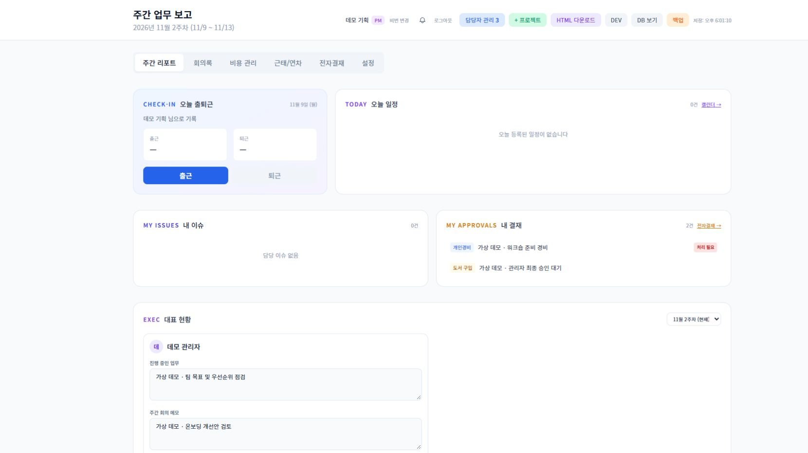

# Merlin Weekly Dashboard

주간 보고, 프로젝트, 할 일, 근태·휴가와 결재를 한곳에서 관리하는 팀 대시보드입니다. Python 3.12의 FastAPI, PostgreSQL, Alpine.js와 Tailwind CSS를 사용합니다.

독립적으로 설치하는 공개 소스입니다. 기존 사용자, 실제 업무 자료, 운영 DB와 외부 연동 계정은 포함하지 않습니다. 설치자가 새 DB와 초기 관리자를 준비합니다.

## 주요 기능

- 주간·개인 보고, 체크리스트, 댓글과 메모
- 프로젝트 계층, 칸반과 할 일, 선택 Linear 동기화
- 일정과 회의록, 선택 Google Calendar 연동
- 출퇴근, 월간·연간 근태 상세, 영업일 누락 확인, 휴가·반차와 승인
- 결재 문서, 승인선, 지출과 내보내기
- 선택 CS·매출·사용량 지표, 요약과 알림
- 팀·계정·역할 설정, 파일 업로드, 활동 기록과 백업·복구

범위와 설정 조건은 [기능 안내](docs/FEATURES.md)에 있습니다. 분석·CS 기능에는 자신의 데이터 소스가 필요합니다. 미설정 상태의 빈 값이나 0을 실제 실적 0으로 해석하지 마세요.

## 화면 미리보기

[PM 계정으로 캡처한 기능별 화면](docs/SCREENSHOTS.md)에서 주간 리포트·회의록·비용·근태/연차·전자결재·설정 탭을 확인할 수 있습니다. PM 화면 20장, 관리자 화면 2장, 별도 CS 화면 2장으로 구분했습니다. 이름·업무·인사·금액은 모두 가상 예시입니다.



## 빠른 설치

필수 도구는 Python 3.12와 Docker Engine 또는 Docker Desktop, Docker Compose v2입니다. 소스를 내려받은 뒤 저장소 루트에서 실행합니다.

### 1. 새 로컬 설정 생성

```sh
python scripts/setup_env.py
```

`.env.example`을 바탕으로 `.env`를 만들고 DB 비밀번호와 JWT 서명키를 무작위 생성합니다. 비밀값은 화면에 출력하지 않으며 기존 `.env`는 덮어쓰지 않습니다. `.env`를 커밋하지 마세요.

### 2. 앱과 새 데이터베이스 실행

```sh
docker compose up --build -d db app
```

PostgreSQL 16은 Compose 내부에서만 접근하며 앱은 `127.0.0.1:8080`에 열립니다. 앱이 DB 테이블을 초기화한 뒤 브라우저에서 `http://localhost:8080/api/health`의 정상 응답을 확인합니다.

### 3. 초기 관리자 생성

```sh
docker compose --profile tools run --rm bootstrap --name 관리자 --email admin@example.com
```

이름과 이메일은 자신의 값으로 바꾸세요. 비밀번호는 명령 인수로 넣지 않고 숨김 입력으로 두 번 입력합니다. 최소 12자이며 UTF-8 기준 최대 1,024바이트입니다. 이미 사용자가 있는 DB에서는 이 명령이 거부됩니다.

`http://localhost:8080`을 열어 생성한 개인 계정으로 로그인하고 팀원·역할·승인자를 설정합니다. 기본 계정이나 공용 비밀번호는 없습니다.

### 중지와 다시 실행

```sh
docker compose down
docker compose up -d db app
```

일반 중지는 DB 볼륨을 삭제하지 않습니다. 기본 Compose는 DB를 영속 볼륨에 저장하지만 컨테이너의 `data/` 임시 파일은 재생성 시 사라질 수 있습니다. 보관할 백업·첨부파일의 별도 저장 위치를 준비하세요. 외부 공개 전에는 HTTPS, 프록시, 비밀 저장소와 접근 정책을 자신의 환경에 맞게 설정해야 합니다.

## 설정과 개발

기본 설치는 `BACKGROUND_TASKS_ENABLED=false`, `STORAGE_AUTO_CREATE_BUCKET=false`, `LEGACY_SHARED_LOGIN_ENABLED=false`입니다. 외부 서비스 키와 자원 ID도 비어 있습니다. 연동은 설치자가 명시적으로 설정한 뒤 사용합니다.

| 문서 | 내용 |
| --- | --- |
| [개발 안내](docs/DEVELOPMENT.md) | 네이티브 실행, 소스 구조, 생성 파일과 검증 명령 |
| [구조 안내](docs/ARCHITECTURE.md) | 구성 요소, 데이터 흐름과 인증 경계 |
| [선택 연동](docs/INTEGRATIONS.md) | Slack·Linear·Google·CS·분석·파일 저장소 설정 |
| [개인정보와 데이터](docs/PRIVACY.md) | 저장 위치, 외부 전송, 공개하면 안 되는 자료 |
| [보안 정책](SECURITY.md) | 설치 시 보안 경계와 취약점 신고 |
| [기여 안내](CONTRIBUTING.md) | 변경·검증·PR 작성 원칙 |

개발 모드의 API 문서는 `/docs`와 `/openapi.json`에서 확인할 수 있습니다. `PORT` 등이 설정된 운영 모드에서는 비활성화됩니다. 선택 Cloudflare Containers 래퍼는 [cf/](cf/)에 있으며 로컬 실행에는 필요하지 않습니다.

## 문제 해결

| 증상 | 확인할 내용 |
| --- | --- |
| 앱이 시작되지 않음 | `.env` 존재 여부, `JWT_SECRET`과 `DATABASE_URL`, Docker 로그를 확인합니다. |
| 관리자 초기화가 실패함 | 앱의 테이블 초기화 완료와 DB 연결을 확인합니다. 기존 사용자가 있으면 초기화 명령을 재사용할 수 없습니다. |
| 기본 비밀번호로 로그인할 수 없음 | 기본 비밀번호는 없습니다. 초기화 때 지정한 이메일과 비밀번호를 사용합니다. |
| 일정·지출·CS·지표가 비어 있음 | 해당 연동의 자격증명, 자원 ID, 소스 형식과 오류 응답을 확인합니다. |
| 화면 동작이 로드되지 않음 | 기본 Alpine.js CDN 접근과 브라우저 콘솔을 확인합니다. 오프라인 사용은 [개인정보 안내](docs/PRIVACY.md)를 참고하세요. |

## 라이선스

프로젝트 코드는 [MIT License](LICENSE)로 제공합니다. 서드파티 의존성과 자산의 라이선스는 별도로 유지되며 [서드파티 고지](THIRD_PARTY_NOTICES.md)를 참고하세요.
