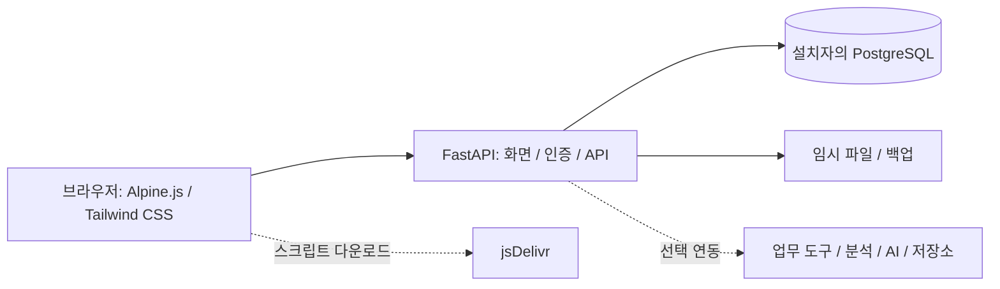

# 구조 안내

## 구성

FastAPI 서버가 화면 파일과 JSON API를 함께 제공합니다. 프런트엔드는 Alpine.js로 상태와 화면 동작을 처리하며, Tailwind CSS는 미리 생성한 정적 파일을 사용합니다. 별도의 프런트엔드 개발 서버는 필수가 아닙니다.

| 경로 | 역할 |
| --- | --- |
| `src/main.py` | FastAPI 앱, 인증·역할, 데이터 초기화, 업무 API와 외부 연동 |
| `src/attendance_policy.py` | DB와 분리한 근태 날짜·반차·영업일 누락 표시 정책 |
| `src/passwords.py` | 솔트를 사용하는 비밀번호 해시와 검증 |
| `src/installation_policy.py` | 설치자 설정, 기능 활성화 여부, 초기 팀 설정 |
| `src/util.py` | 보고 병합과 지표 변환 등 순수 함수 |
| `src/cs_metrics.py` | 선택 CS 데이터 수집·집계·분류 |
| `static/index.html`, `static/partials/` | 메인 화면과 화면 조각 |
| `static/app.js`, `static/js/core.js` | 클라이언트 동작과 공통 함수 |
| `src/cs_app.src.html`, `src/cs_app.html` | CS 화면의 편집용 소스와 제공용 생성 파일 |
| `tailwind/`, `static/tailwind.css` | CSS 빌드 입력과 생성 파일 |
| `scripts/` | 관리자 초기화, 테스트·빌드 등 보조 명령 |
| `tests/` | 오프라인 정책·화면 검사 및 별도 서버·DB를 사용하는 검사 |
| `cf/` | 선택 Cloudflare Containers 프록시 |

## 데이터 흐름과 인증

개인 계정으로 로그인하면 서버가 JWT를 발급하고 브라우저가 이후 API 요청에 전달합니다. 서버의 인증·권한 검사와 각 기능의 승인 규칙을 거쳐 PostgreSQL에 접근합니다. 초기 관리자 생성은 비어 있는 설치에서만 실행되며 기존 사용자를 승격하거나 덮어쓰지 않습니다.

일반 대시보드와 CS 화면은 인증 범위가 다릅니다. 정적 화면과 클라이언트의 숨김 처리는 보안 경계가 아니므로 API의 권한 검사를 유지해야 합니다. 외부 DB나 Data API를 직접 공개하면 앱의 인증 처리를 우회하게 되므로 DB 자체의 접근 정책도 필요합니다.

## 설계상 주의점

보고 저장은 식별자를 기준으로 병합하여 다른 사용자가 추가한 항목을 보존하고 삭제 표시를 반영합니다. 근태 표시 정책은 조회 결과를 보완하며 원본 출퇴근·승인 기록을 바꾸지 않습니다. 이 경로를 수정할 때는 동시 편집과 원본 보존 테스트를 함께 확인하세요.

외부 분석 자료는 앱 자체 업무 데이터와 별개입니다. 캐시나 화면에 숫자가 있어도 원본 조회의 성공 여부와 기간을 확인해야 합니다. 예약 작업은 설치자가 명시적으로 활성화하며, 외부 서비스와 파일 저장소의 권한·보관 정책은 앱 DB와 별도로 관리합니다.
